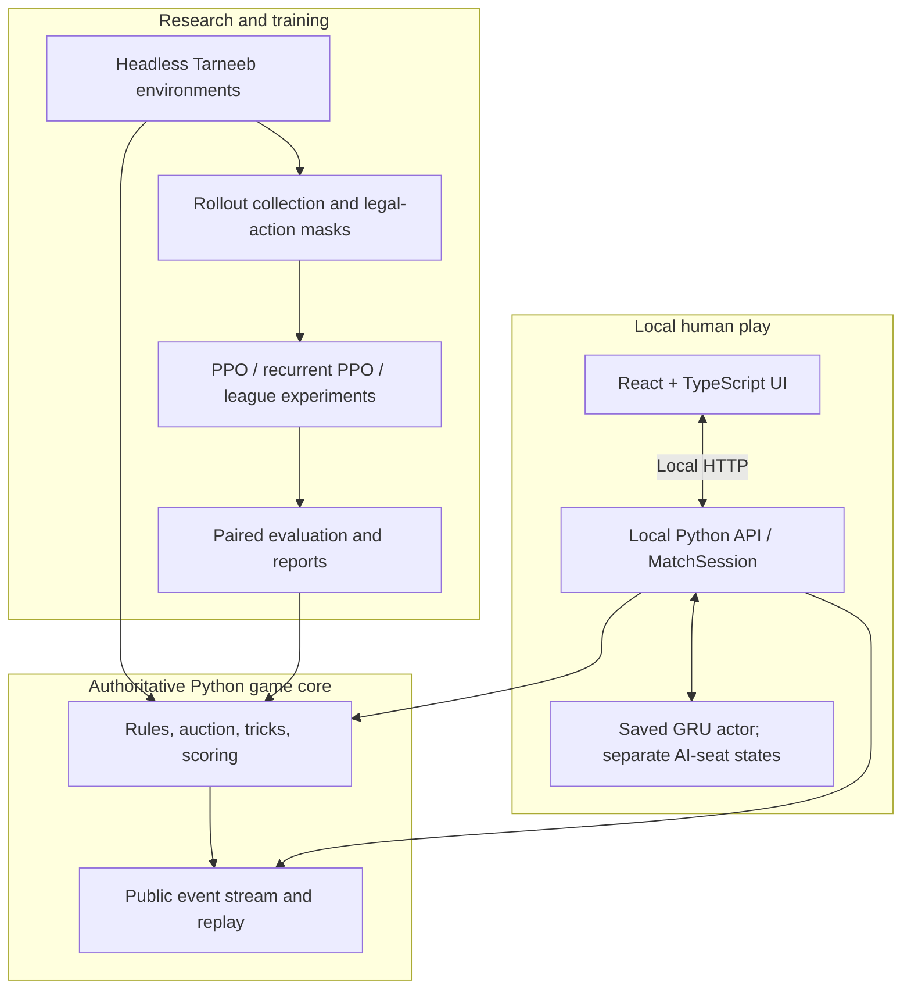

# Tarneeb-RL

**A reproducible research platform for multi-agent reinforcement learning in Tarneeb.**

A deterministic, rules-verified implementation of the four-player partnership card game, paired with masked PPO, event-history GRU agents, controlled ablation studies, and a playable local browser interface. The project is built to distinguish **an agent that runs** from **an agent whose performance has been measured reliably**.

**Python 3.12** · **PyTorch** · **NumPy** · **PPO / GRU** · **React + TypeScript** · **Vite** · **Local-first**

> **Project status — 6 November 2026**
> Phases **1–13** are implemented in the local Git history. Phase 13 is frozen at **`bd32b1c`**; the preceding Phase 12 research freeze is **`6066303`**. The browser game is operational locally, and its focused tests, TypeScript check, and Vite build passed. **The research conclusions are intentionally conservative:** A1, A2, and A3 did not demonstrate a reproducible seed-level improvement at their registered budgets. Phase 12 retains explicitly deferred evaluation work. This is a research/portfolio project, **not an online gaming service**.

---

## Contents

- [Why this project exists](#why-this-project-exists)
- [What is implemented](#what-is-implemented)
- [Architecture](#architecture)
- [Play locally](#play-locally)
- [Game rules](#game-rules)
- [Learning approach](#learning-approach)
- [Research results](#research-results)
- [Development timeline](#development-timeline)
- [Testing and reproducibility](#testing-and-reproducibility)
- [Repository guide](#repository-guide)
- [Limitations and roadmap](#limitations-and-roadmap)
- [Project ownership and license](#project-ownership-and-license)

## Why this project exists

Tarneeb is an **imperfect-information, cooperative-competitive game**: four players hold private cards, two pairs compete, bidding influences the contract, and a player must cooperate with a partner without seeing that partner's hand. These constraints make it a useful environment for studying multi-agent decision-making beyond single-agent reward maximization.

This project investigates three primary questions:

1. **Memory:** Does a GRU encoding the ordered public-event history outperform a feedforward policy using padded history?
2. **Training information:** Does a centralized, privileged-information critic improve the strength of an otherwise identical decentralized actor?
3. **Opponent diversity:** Does prioritized fictitious self-play (PFSP) improve generalization compared with latest-only self-play?

The project also studies partner compatibility, evaluation fairness, contract behavior, and what can—and cannot—be concluded from limited training seeds. A practical goal is to **play with the trained agent as a partner** against two AI opponents using a local UI.

## What is implemented

| Area | Implemented capability |
| --- | --- |
| **Game engine** | Four-player deal, strict auction, trump selection, legal trick play, scoring, match progression, seeded replay |
| **Correctness** | Rule fingerprints, exhaustive auction verification, scoring truth table, action masking, determinism and replay tests |
| **Agents** | Random legal, Basic heuristic, Strong heuristic, feedforward neural, recurrent neural |
| **Reinforcement learning** | Masked PPO, behavior cloning initialization, sequence/chunk replay, recurrent rollout management, curriculum experiments |
| **Multi-agent research** | Centralized vs decentralized critics, latest-only vs PFSP league experiments, seat-balance pilot, checkpoint cross-play |
| **Evaluation** | Duplicate-deal paired comparisons, independent training seeds, confidence intervals, role/contract diagnostics, human-play protocol |
| **Local play** | Browser-based React game, Python match server, trained GRU opponent/partner inference, human seat 0, two-press card selection |

### Local game interface

The Phase 13 interface uses the original custom table design rather than Streamlit. It is **Arabic-first**, retains the existing game visuals, and connects to the authoritative Python match session rather than simulating scores in the browser.

- **Human:** seat 0 (bottom)
- **AI teammate:** seat 2 (opposite)
- **AI opponents:** seats 1 and 3
- **Card input:** first press selects/raises a legal card; the **second press on that same card** plays it. Selecting another card changes the selection; busy/illegal submissions are blocked.
- **Gameplay:** bidding, trump selection, 13 tricks, deal scoring, next deal, and match progression
- **Session model:** one in-memory local match; browser refresh reconnects to it, and stale actions from other tabs are rejected

The UI is intended for **localhost**. There is no authentication, matchmaking, production database, or hosted deployment.

## Architecture

The project deliberately separates the game rules from the learning code and user interface.



### Important design contracts

**The core engine is framework-independent.** It does not depend on PyTorch or the frontend. All applications and training systems consume its verified rules.

**Only observable information reaches a playing policy.** The actor can use its own hand, public auction/play events, scores, current trick, trump, and legal-action mask; it cannot inspect opponents' unplayed cards. A centralized critic may use privileged state **during training only**, never for actor inference.

**Recurrent state belongs to a particular policy and seat.** Events are consumed once in order, and hidden state resets at new deals. Following an identified stale-state defect in Phase 9, the principal recurrent training pipeline finishes active deals before optimizer updates, preventing hidden states created with old weights from being carried into new-weight rollouts.

| Interface | Frozen contract |
| --- | --- |
| Rules | `tarneeb-classic-v1` |
| Action space | `act_v1`, 65 IDs; no-trump action permanently illegal |
| Observations | `obs_v2`, 692 actor-visible static features; 856 for centralized critic input |
| Public events | `event_v1`, ordered and seat-relative |
| Deal recording | `deal_v2`, replayable |
| Recurrent model | `event_gru_actor_critic_v1` |
| Recurrent storage | `chunk_v2`, 16-decision chunks |

The game rules are documented in [`docs/RULES.md`](docs/RULES.md). Model and buffer
implementations live in `tarneeb/models/` and `tarneeb/buffers/`; their detailed
research-contract documents are retained in the local research archive.

## Play locally

### Requirements

- Windows x64 / PowerShell and **Python 3.12** (tested with 3.12.10)
- **Node.js 22.12 or newer in the 22.x series**, including npm (tested: 22.16.0 / npm 10.9.2)
- Internet for dependency installation; no API keys, database, Replit account, or GPU required
- The exact champion below, in the repository's `checkpoints/` directory

### Trained champion availability

The local-play distribution includes one verified 21.78 MiB champion checkpoint,
listed below. This is the only model allowed by `.gitignore`; other training
checkpoints, datasets, and run outputs remain local. No training or separate model
download is needed when this checkpoint is present in your checkout.

| Property | Verified value |
| --- | --- |
| File | `checkpoints/phase9_gru_bc_s0_update250.pt` |
| Size | 22,832,585 bytes (21.78 MiB) |
| SHA-256 | `73ef1ec852a060f788e94208637e528e4a2d9cc55361da8202cc31de2f27a546` |
| Format / architecture | `ppo_gru_v1` / `event_gru_actor_critic_v1` |
| Training snapshot | 250 updates; 689,456 environment steps |

The server verifies the checksum before loading. It refuses missing or different weights;
there is no silent heuristic fallback. The frozen loader then checks rules, observations,
actions, events, model and buffer versions. Only the actor is used for play. Do not load
arbitrary PyTorch checkpoints with the research loaders, which use pickle.

After cloning or unpacking the project, confirm that this file is present and run the
checksum command below. If it is missing, obtain the project revision or source archive
that includes the checkpoint; do not substitute arbitrary weights or disable validation.
The checksum and local-play verification steps are documented here; internal
publication audits are retained locally.

### 1. Install Python dependencies

Open PowerShell **in your checkout's root directory**, wherever you cloned or unpacked it.
No particular drive or personal directory is required.

```powershell
py -3.12 -m venv .venv
.\.venv\Scripts\python.exe -m pip install -r requirements.lock
.\.venv\Scripts\python.exe -m pip install -e . --no-deps
.\.venv\Scripts\python.exe -m pip check

$expected = '73ef1ec852a060f788e94208637e528e4a2d9cc55361da8202cc31de2f27a546'
$actual = (Get-FileHash .\checkpoints\phase9_gru_bc_s0_update250.pt -Algorithm SHA256).Hash
if ($actual.ToLowerInvariant() -ne $expected) { throw 'Champion checksum mismatch' }
```

The existing Windows lockfile installs the research/test environment, including CPU
PyTorch 2.14.0, NumPy and pytest. CUDA and the optional Streamlit interface are not needed
to play. Virtual-environment activation is unnecessary because commands name Python directly.

### 2. Install the frontend

From the same root directory:

```powershell
powershell -NoProfile -ExecutionPolicy Bypass -File .\scripts\phase13-ui.ps1 install
```

This runs `npm ci` against the standalone frontend lockfile. The process-scoped execution
policy option permits this reviewed local script without changing the machine's policy.
The original Replit workspace remains intact for provenance. Install the playable app
through this helper, which uses its standalone npm manifest rather than the workspace root.

### 3. Start the Python server (terminal 1)

```powershell
# Run from your checkout root.
.\.venv\Scripts\python.exe -m tarneeb.local_ui.server
```

### 4. Start the browser interface (terminal 2)

```powershell
# Open another PowerShell terminal in the same checkout root.
powershell -NoProfile -ExecutionPolicy Bypass -File .\scripts\phase13-ui.ps1 dev
```

Open **http://127.0.0.1:5173**. Both servers bind to loopback. Vite forwards `/api` to
Python at `127.0.0.1:8765`. Keep these default ports together; changing the backend port
also requires updating the Vite proxy. This is a local development app, not a public server.
Press Ctrl+C in each terminal to stop. No scores persist across Python restarts.

Choose Play from the menu. Bid or pass when prompted, select trump if you win the auction,
and press a legal card twice to play it. Seat 2 is your AI partner. After scoring, choose
Next deal; the match target is 31. See [local play notes](docs/PHASE13_LOCAL_UI.md).

### Alternative: command-line play

A terminal-based human-play interface was implemented before Phase 13:

```powershell
.\.venv\Scripts\python.exe -m tarneeb.app.cli --checkpoint checkpoints/phase9_gru_bc_s0_update250.pt --deals 4 --opponents strong
```

This CLI command is a separate, earlier local-play route; it is **not** the React application startup command.

## Game rules

The implemented variant is **`tarneeb-classic-v1`**, with rules defined in the repository rather than inferred from a UI or external platform.

| Rule | Behavior |
| --- | --- |
| Players | Four seats, fixed teams **(0, 2)** and **(1, 3)** |
| Deck | Standard 52 cards; 13 cards per seat; ace high |
| Auction | Counter-clockwise; bids **7–13**, strictly increasing; Pass is permanent |
| All-pass | Redeal with the **same dealer**; no score |
| Trump | Winning bidder selects clubs, diamonds, hearts, or spades; **no no-trump** |
| Play | Follow the led suit if possible; highest trump wins, otherwise highest led suit |
| Match | First team reaching the **31-point target** under the frozen match rules |

### Scoring, in precedence order

Let `b` be the bid, `tB` the bidding team's tricks, and `tD = 13 - tB`.

| Condition | Bidding team | Defending team |
| --- | ---: | ---: |
| Bid 13 and win all 13 | +26 | 0 |
| Bid 13 and fail | −16 | `2 × tD` |
| Bid below 13 and take all 13 (bidder kaboot) | +16 | 0 |
| Bid below 13 and defenders take all 13 (defender kaboot) | `−b` | +16 |
| Otherwise, made contract (`tB ≥ b`) | `+tB` | 0 |
| Otherwise, failed contract | `−b` | `+tD` |

**Precedence matters.** On a failed bid of 13 with zero bidder tricks, the result is **(−16, +26)**, *not* (−16, +16). The scoring implementation is checked against an independently written **98-case truth table** (`7 bids × 14 possible trick totals`).

## Learning approach

### From heuristics to neural agents

1. **Trusted baselines** — Random legal play and two hand-crafted, public-information heuristic agents provide reproducible opponents and a behavior-cloning teacher.
2. **Masked PPO** — The actor predicts actions only within the legal-action mask; illegal actions and no-trump selection are excluded rather than penalized after execution.
3. **Behavior cloning (BC)** — Supervised imitation of the Strong heuristic initializes feedforward and recurrent policies before PPO fine-tuning.
4. **Event-GRU memory** — An ordered public-event encoder feeds a GRU with a 256-dimensional hidden state. It is designed to retain relevant auction and play history without seeing private opponent hands.
5. **Critic ablation (CTDE)** — Training compares the same recurrent actor with decentralized vs privileged centralized value inputs. Inference remains decentralized.
6. **League self-play / PFSP** — Training and evaluation compare latest-only opponents with a league-based opponent-selection approach, including seating and cross-play analysis.

The principal PPO reward is the normalized **team score change minus the opposing team's score change**, emitted at scored deal completion; all-pass redeals are not falsely treated as scoring terminals.

### Reproducibility safeguards

- Seeded deterministic deals and replayable action/event histories
- Stable rules and interface versions embedded in artifacts
- Independent held-out evaluation seed paths
- Duplicate-deal pairing with team swaps to reduce deal and seat effects
- Matched, pre-registered training budgets for comparisons
- Multi-seed inference with **seed-level**, not only pooled deal-level, intervals
- Explicit recording of failed runs, implementation defects, and negative findings
- Actor-only inference with independent recurrent state for each AI seat

## Research results

### A1–A3: primary architecture and training comparisons

The following are **three-training-seed** estimates versus the **Strong heuristic**, in mean paired score points per duplicate-deal pair. A positive value favors the first condition. The intervals are 95% Student-*t* intervals across seeds; they are deliberately not replaced with narrower pooled-deal intervals.

| Study | Comparison | Mean difference | 95% seed-level interval | Registered-budget conclusion |
| --- | --- | ---: | ---: | --- |
| **A1** | Event-GRU − feedforward | **+0.438** | [−0.766, +1.642] | No detectable difference |
| **A2** | Centralized critic − decentralized critic | **−0.219** | [−1.496, +1.059] | No detectable actor-strength difference |
| **A3** | PFSP league − latest-only self-play | **−0.467** | [−1.731, +0.796] | No detectable PFSP advantage |

**How to read this:** every interval crosses zero. The experiments do **not** establish that the methods are equivalent, and they do **not** prove that recurrence, centralized critics, or PFSP can never help. Their benefits were simply not reproducibly detected under these particular budgets, seeds, and opponents.

**Important A2 nuance:** the centralized critic's final explained variance improved (approximately **0.594 versus 0.449**) without a corresponding demonstrated actor-strength advantage. Better value prediction alone is not sufficient evidence of a stronger playing policy.

### Additional findings and completed evaluation work

| Work | Evidence / outcome |
| --- | --- |
| **Rules and engine correctness** | Independently verified auction graph: **1,703 terminal auction sequences**, **2,401 decision nodes**, maximum length 10; deterministic replay and legal-action tests |
| **Recurrent training correctness** | A stale-state-across-optimizer-steps defect was identified, invalid runs quarantined, and a complete-deal collection safeguard implemented and tested |
| **A3 league evaluation** | **99 matchups**, **54,000 duplicate pairs**, **108,000 played deals** across the saved registered evaluation campaign; no qualified new champion promotion |
| **Balanced-seating pilot** | Compared balanced vs legacy seat exposure with a limited training pilot; observed effects were **inconclusive** |
| **A7 auction-history ablation** | Historical single-training-root study only; insufficient to make a multi-seed claim about the value of auction memory |
| **E6 cross-seed comparisons** | Three independently seeded final GRU policies compared at **1,000 duplicate pairs per pairing** |
| **E7 partner compatibility** | Six homogeneous/mixed-policy lineups evaluated against Strong, **1,000 duplicate pairs each**; effects varied by pairing and do not establish broad compatibility |
| **E8 human evaluation** | **30 human-played scored deals**, recorded as *operator-attested, not independently authenticated* |

In the saved E7 analysis, one nominal familiar-versus-mixed pairing gap excluded zero, while two did not. This is **exploratory evidence**, not a family-wise-corrected or generally proven partnership effect. The E7 lineups still had negative paired scores against Strong.

**Champion used in the local app:** `checkpoints/phase9_gru_bc_s0_update250.pt`. Despite later experimentation, **no Phase 11 or 12 candidate met the promotion criterion**. Keeping the previous champion is an intentional evidence-based decision, not an omitted retraining step.

### What was not completed

Phase 12 was frozen with explicit scope exceptions, not represented as perfect blueprint compliance:

- **E5:** 736 additional registered-archive checkpoint comparisons remain deferred; completing them would require approximately **441,600 additional played deals** at the registered sampling convention.
- **A7:** an independent multi-seed rerun of the auction-history ablation was not completed.
- Some historical role-level and bid-level aggregates cannot support more specific causal or calibration conclusions; E7 adds targeted new observations but not a universal, high-precision bidding model.
- The available evaluation does not establish superiority over expert human players or all potential game-playing agents.

Detailed evidence audits and research reports are retained in the local research
archive and are not included in this distribution. Intermediate checkpoints and
result files should not be treated as newly held-out data after they have been examined.

## Development timeline

This repository was developed through individually scoped phases and frozen Git history, rather than one monolithic implementation.

| Phase | Delivered work |
| ---: | --- |
| **01** | Frozen Tarneeb rules, fingerprinting, and fully enumerated scoring tests |
| **02** | Auction state machine, strict bidding, all-pass handling, trump choice |
| **03** | Trick-taking engine, recorded public events, deterministic replay |
| **04** | RL environment, legal actions, public observations, leakage tests |
| **05** | Random / Basic / Strong baseline agents and paired evaluation arena |
| **06** | Feedforward masked PPO, rollout buffers, learning and resume checks |
| **07** | Curriculum and historical auction-memory experiments; CLI human play |
| **08** | Event-GRU and recurrent PPO infrastructure; event-consumption safeguards |
| **09** | Behavior cloning, multi-seed recurrent PPO, A1 ablation; G6 defect resolved |
| **10** | Centralized-critic A2 experiment and deterministic reproduction checks |
| **11** | PFSP-vs-latest-only self-play A3, checkpoint cross-play, seating pilot |
| **12** | Consolidated evidence audit, expanded E6/E7 tests, 30-deal human study, documented deferrals |
| **13** | Original React game UI connected to Python engine and saved GRU actor; tested local play |

**Preserved freeze points**

| Freeze | Git reference | Meaning |
| --- | --- | --- |
| Phase 10 | `0b032bf` | Centralized critic A2 implementation and results |
| Phase 11 A3 | `ba0d801` | PFSP ablation freeze |
| Seating pilot | `011a530` | Balanced-seating pilot; inconclusive |
| Phase 12 | `6066303` | Final research evidence/archive freeze with documented exceptions |
| **Phase 13** | **`bd32b1c`** | **Local React + Python + trained-agent integration** |

Commits are reproducible source snapshots, **not** claims that all original research hypotheses succeeded.

## Testing and reproducibility

The local-play and publication safety checks cover champion loading, independent
AI-seat memory, legal play, scoring, and HTTP request validation. The 10 focused
tests passed from an isolated export using the existing Python environment; this
does not certify a fresh dependency installation or a remote clone.

Historical research scripts that hash preregistration documents or archived
evidence require the separate local research archive. Those documents, intermediate
checkpoints, and raw results are not distributed here. This does not affect the
local game or its focused tests.

### Backend tests

```powershell
# Phase 13 integration and publication safety tests
.\.venv\Scripts\python.exe -B -m pytest tests/test_phase13_local_ui.py tests/test_publication_local_ui.py -q -p no:cacheprovider

# Broader suite (can take longer; not rerun as part of the Phase 13 freeze)
.\.venv\Scripts\python.exe -m pytest tests -q
```

### Frontend checks

Run from the root directory using the committed helper script:

```powershell
.\scripts\phase13-ui.ps1 typecheck
.\scripts\phase13-ui.ps1 test
.\scripts\phase13-ui.ps1 build
```

**Verified at the Phase 13 freeze:** TypeScript typecheck passed; **2 Vitest tests passed**, including exactly-two-press submission and duplicate/illegal-action rejection; Vite production build succeeded. The full interactive experience was reported operational locally, but these automated checks should **not** be interpreted as exhaustive browser end-to-end coverage.

### Experiment interpretation

The principal comparison metric is **paired score difference** on identical deals, with sides swapped. Reports also use bootstrap intervals, Wilson intervals for decisive win rates, and a **three-seed Student-*t* interval** as the governing inference for architecture comparisons. A single impressive deal-level interval is not used to overrule the multi-seed result.

Training uses isolated seed ranges from final evaluation. Source hashes, checkpoint metadata, frozen experiment configurations, and replay records support reproducibility. Results requiring large checkpoints or non-Git evaluation directories must be obtained from the original local archives or regenerated; a fresh Git clone alone is not a complete binary research archive.

## Repository guide

```text
Tarneeb-RL/
├── tarneeb/
│   ├── core/                 # Cards, rules, auction, tricks, scoring, replay
│   ├── env/                  # Observation contracts, legal masks, rewards
│   ├── agents/               # Baselines and neural inference adapters
│   ├── models/               # Feedforward, GRU, critics, checkpoints
│   ├── buffers/              # Flat, recurrent and BC data contracts
│   ├── training/             # PPO, BC, rollout and experiment drivers
│   ├── evaluation/           # Paired arena, metrics, statistical reports
│   ├── curriculum/           # Curriculum experiments
│   ├── app/                  # Original local CLI and match session
│   └── local_ui/             # Phase 13 Python localhost server
├── phase13-ui-original/
│   └── artifacts/mockup-sandbox/
│       ├── src/              # Original React game and UI components
│       ├── vite.local.config.ts
│       └── tsconfig.local.json
├── scripts/                   # Training, evaluation and UI runners
├── configs/                   # Versioned model, training and ablation settings
├── tests/                     # Engine, RL, safety and integration tests
├── docs/                      # Public game rules and local-play guide
├── pyproject.toml
└── README.md

# Local-only: results/ runs/ data/ .venv/ node_modules/ dist/
# checkpoints/: the verified local-play champion is included; other weights stay local.
```

Start with [`docs/RULES.md`](docs/RULES.md) for the game specification and
[`docs/PHASE13_LOCAL_UI.md`](docs/PHASE13_LOCAL_UI.md) for the working interface.
Other documentation stays in the ignored local archive. The larger
`tarneeb-rl-blueprint-v1.2.md` is a design specification; **verified tests and
committed code take precedence** if a proposed number or design differs from
implementation evidence.

## Limitations and roadmap

The project prioritizes **scientific traceability over inflated benchmark claims**. Important current limitations include small multi-seed sample sizes, limited PPO training budgets, narrow opponent families in some experiments, non-availability of large artifacts in Git, and incomplete all-checkpoint cross-play. Some saved policies are weaker than the Strong heuristic. The model does not learn online from human games; inference does not mutate its weights.

**Next research milestone — Phase 14:** write the academic/portfolio report, integrating controlled comparisons, negative findings, provenance, partner-compatibility observations, and unresolved questions. **Phase 15** (public deployment) is optional and not implemented. Authentication, accounts, online matchmaking, cloud hosting, and production APIs are outside the current local-play scope.

## Project ownership and license

**Project:** Tarneeb-RL
**Development:** Mohammad Almousa
**Focus:** Multi-agent reinforcement learning, imperfect information, reproducible evaluation, and local human–AI collaboration.

The project includes an MIT [LICENSE](LICENSE). The owner has approved including the specific local-play champion listed above. Third-party dependencies retain their own licenses and applicable notice requirements. Cards and icons in the active UI are rendered in code; font files are not bundled. This project is **not affiliated with or endorsed by Jawaker or any other commercial Tarneeb platform**.

---

<p align="center"><strong>Built to play Tarneeb. Designed to make every research claim auditable.</strong></p>
